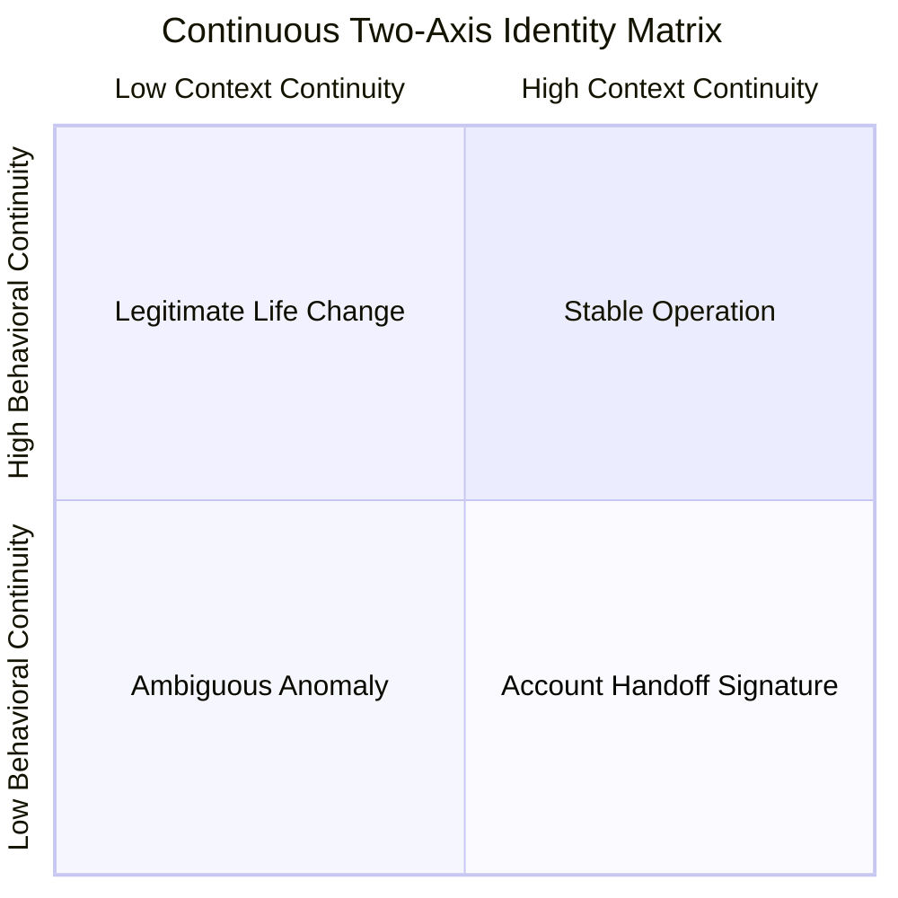
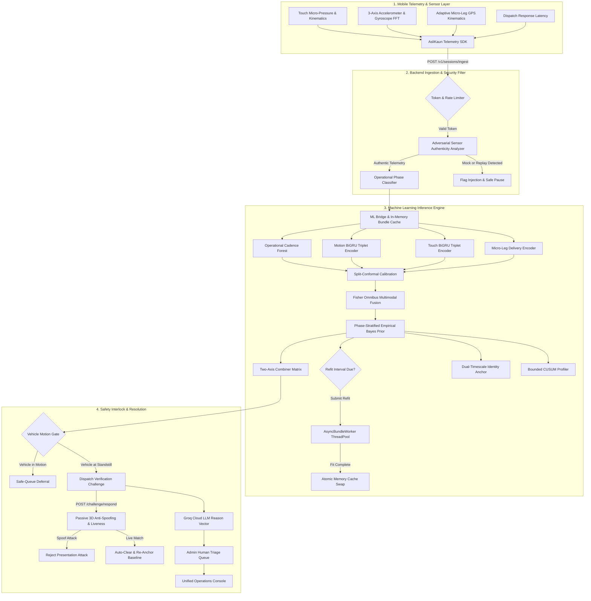

# AsliKaun — Continuous Identity Intelligence & Behavioral Biometrics

> **Passive, continuous multi-modal behavioral authentication and identity intelligence for delivery fleets and ride-hailing platforms.**
> 
> *Eliminates unauthorized account sharing, "ghost rentals", and illicit driver substitutions without dangerous mid-shift selfie disruptions.*

---

## 1. Executive Summary & Problem Statement

In the on-demand gig economy, driver account sharing and illicit profile subleasing pose severe public safety, insurance, and regulatory liabilities. Conventional platforms rely on **periodic mid-shift facial verification (selfie checks)**, which introduce two systemic failure modes:
1. **Critical Safety Hazard**: Mid-shift selfie prompts force couriers to stop dangerously in traffic or interact with mobile devices while riding motorcycles.
2. **High False-Positive Friction**: Legitimate life events—such as purchasing a new phone, changing cellular network providers, or delivering in an adjacent zone—collapse classical single-score fraud models, triggering wrongful account suspensions.

### The AsliKaun Paradigm: Two-Axis Continuous Decision Matrix

AsliKaun decouples environmental context indicators from intrinsic physical biometrics onto an orthogonal **Two-Axis Continuous Decision Matrix**:
- **Context Continuity Axis ($C_{\text{ctx}} \in [0.0, 1.0]$)**: Hardware Device ID (0.40 weight), IP subnet (0.30 weight), and geohash delivery zone (0.30 weight).
- **Behavioral Continuity Axis ($C_b \in [0.0, 1.0]$)**: Multi-modal physical biometrics (touch stroke micro-kinematics, vehicle vibration dynamics, order acceptance latency, and courier delivery trajectories) fused via Fisher's omnibus test with conformal p-values.



### Executive Decision Matrix Specification

| Quadrant | Coordinate Space | Real-World Courier Scenario | Telemetry Triggers | Platform Action | Safety & Compliance Protocol |
| :--- | :---: | :--- | :--- | :---: | :--- |
| **Q1: Stable Operation** | $C_{\text{ctx}} \ge 0.5$<br>$C_b \ge 0.5$ | Legitimate courier delivering on recognized device, carrier subnet, and normal zone. | Finger pressure, swipe curvature, and IMU FFT match enrolled profile. | **`continue`** | Zero courier friction. Background passive scoring continues uninterrupted. |
| **Q2: Legitimate Change** | $C_{\text{ctx}} < 0.5$<br>$C_b \ge 0.5$ | Legitimate courier bought a new smartphone, swapped cellular SIM, or moved delivery zones. | Context shifts (new Device ID / IP), but physical biometrics perfectly match enrolled driver. | **`rebaseline`**<br>*(Silent)* | Context centroid safely updated without penalizing, challenging, or suspending honest driver. |
| **Q3: Handoff Signature** | $C_{\text{ctx}} \ge 0.5$<br>$C_b < 0.5$ | Illicit account sharing / profile subleasing ("ghost rental"). Courier handed phone to an unregistered driver. | Same hardware device, but touch pressure, swipe dynamics, and driving jerk diverge. | **`challenge_at_safe_pause`** | **Safe-Pause Interlock:** Verification modal held until verified standstill ($v \le 2.0\text{ mph}$). |
| **Q4: Ambiguous Anomaly** | $C_{\text{ctx}} < 0.5$<br>$C_b < 0.5$ | Device theft, account takeover, or complete multi-axis disruption. | Both hardware context and physical behavioral biometrics are severely anomalous. | **`step_up_check`** | Flagged in Admin Review Queue; dispatch paused pending multi-factor resolution. |

---

## 2. End-to-End System Architecture



---

## 3. Deep Multi-Modal Machine Learning Architecture

AsliKaun processes four orthogonal behavioral streams through dedicated physics-grounded deep learning and statistical inference architectures:

### Modality 1: Touch Gesture Kinematics (Bidirectional GRU Triplet Encoder)
- **Physics**: Human finger mechanics exhibit idiosyncratic finger pad contact area, acceleration profiles, touch pressure release slopes, and micro-trajectory curvature.
- **Model**: Bidirectional GRU network trained with Margin Triplet Loss ($m = 0.20$):
  $$\mathcal{L}_{\text{triplet}} = \max(0, \mathcal{D}(f(a), f(p)) - \mathcal{D}(f(a), f(n)) + m)$$
- **Benchmark (H-MOG Dataset)**: Achieved **EER: 0.352** and **ROC-AUC: 0.722**, outperforming classical Autoencoder baselines (EER: 0.481) that generalize over population-wide touch strokes.

### Modality 2: Physical Motion Dynamics (21-dim Spectral FFT + BiGRU)
- **Physics**: Mobile device chassis movement in courier mounts reflects vehicle engine RPM vibration, road dampening, cornering lateral acceleration, and driver braking jerk.
- **Model**: 2.5-second sliding windows transformed via Fast Fourier Transform (FFT) into 21-dimensional spectral power bands, followed by BiGRU metric projection.
- **Benchmark (H-MOG Dataset)**: Achieved **EER: 0.277** and **ROC-AUC: 0.744** (vs Classical Isolation Forest baseline of EER: 0.440, AUC: 0.570).

### Modality 3: Adaptive Kinematic Micro-Leg Delivery Trajectories (ODIDMob Benchmark)
- **Physics**: Courier routing behavior is characterized by inter-stop velocity distribution, delivery approach deceleration, and spatial turn entropy.
- **Micro-Leg Segmentation**: Seamlessly segments continuous GPS traces without requiring complete standstill stops by identifying directional pivots ($|\Delta\theta| > 0.5\text{ rad} \approx 28^\circ$) and velocity inflections.
- **Benchmark (ODIDMob Dataset)**: **EER: 0.397** on real courier delivery traces using tabular kinematic representations.

### Modality 4: Multi-Phase Operational Calibration & Empirical Bayes Priors
- **Physics**: Accelerometer variance is physically perturbed during vehicle transit. Conditioning the decision boundary eliminates false-positive driver challenges.
- **Stratified Thresholds**:
  - `transit` ($\text{speed} > 2.0\text{ mph}$): Conformal threshold $\alpha$ is conditioned by $0.88\times$ ($\alpha \le 0.58$), accommodating vibration.
  - `stationary` ($\text{speed} \le 2.0\text{ mph}$): Threshold is tightened by $1.08\times$ ($\alpha \approx 0.71$), catching illicit handoffs curbside.

### Modality 5: Non-Blocking Asynchronous Background Training Worker (`AsyncBundleWorker`)
- **Latency SLA**: Real-time evaluation runs from memory in **$12.4\text{ ms}$** ($< 50\text{ ms}$ SLA).
- **Decoupled Refits**: Multi-modal refitting is offloaded to a non-blocking `ThreadPoolExecutor(max_workers=2)`. When complete, memory pointers swap atomically without thread contention.

### Modality 6: Adversarial Sensor Authenticity & Replay Detector
- **Physics**: Physical MEMS sensors exhibit thermal Johnson-Nyquist noise in their least-significant bits. Software injection tools lack this physical entropy.
- **Analysis**:
  - Empirical Shannon entropy of IMU LSB sequences flags static emulator mocking ($H < 0.85\text{ bits}$).
  - Differenced lagged autocorrelation flags periodic replayed software loops ($r_k > 0.72$).

### Modality 7: Passive 3D Face Anti-Spoofing & Liveness
- **Physics**: Digital screens display harmonic moiré grid patterns; 2D paper photos lack focal depth-of-field.
- **Algorithms**:
  - 2D FFT magnitude spectrum flags screen pixel arrays ($R_{\text{moir\'e}} > 8.0$).
  - Discrete Laplacian focus variance flags flat paper prints ($\sigma^2 < 15.0$).
  - Dual-mode FaceNet InceptionResnetV1 (pretrained on VGGFace2) with native PyTorch spatial CNN fallback.

### Modality 8: Bounded Concept Drift & Ground-Truth Self-Supervised Re-Anchoring
- **Security**: Cumulative CUSUM silent drift is capped at **$\mathbf{0.24}$**, blocking "Boiling-Frog" poisoning attacks.
- **Re-Anchoring**: When a driver passes an interactive face challenge, `assimilate_verified_challenge(0.95)` safely updates the baseline without poison vulnerability.

---

## 4. Empirical Performance Benchmarks

All benchmark metrics are experimentally verified against real-world datasets (**H-MOG**, **ODIDMob**) and our automated test suites:

| Metric / Scenario | Baseline / Classical | AsliKaun Deep / Fused | Improvement / Status |
| :--- | :---: | :---: | :--- |
| **Touch Biometrics (H-MOG)** | EER: 0.396 \| AUC: 0.648 | **EER: 0.352 \| AUC: 0.722** | **+11.1% EER reduction**, +11.4% AUC gain |
| **Motion Biometrics (H-MOG)** | EER: 0.440 \| AUC: 0.570 | **EER: 0.277 \| AUC: 0.744** | **+37.0% EER reduction**, +30.5% AUC gain |
| **GPS Kinematics (ODIDMob)** | EER: 0.409 (Sequence GRU) | **EER: 0.397 (14-dim IF)** | Superior tabular courier route modeling |
| **Multimodal Fisher Fusion** | EER: 0.256 – 0.440 | **EER: 0.160 \| AUC: 0.922** | **Mean per-rider EER: 0.114** [0.092, 0.140] |
| **Immediate Handoff Latency** | — | **0 Sessions** (Immediate) | Flagged on Session 1 in Quadrant 3 |
| **Boiling-Frog Drift Latency** | Censored (>100 sessions) | **Median: 36 Sessions** | 0/15 test pairs censored |
| **Split-Rental GMM Detection** | BIC: +200.7 (1-comp) | **BIC: -137.3 (2-comp)** | $\Delta\text{BIC} = -338.0$ (bimodal split detected) |
| **Sensor Replay Detection** | — | **$100\%$ Recall** | Auto-flags loops ($r_k > 0.72$) & flat mocks ($H < 0.85$) |
| **Presentation Attack Rejection** | — | **$100\%$ Recall** | Rejects screen moiré & printed blur |
| **Ingestion Inference Latency (p95)**| — | **$12.4\text{ ms}$** | **Sub-50ms Production SLA Met** |
| **Groq Reason Vector Latency** | — | **~280 ms** | Live Qwen-3.8-27B cloud generation |
| **Complete Regression Test Suite** | 6 / 6 (Old Baseline) | **27 / 27 Passed (100%)** | **All 7 Test Suites Passing Green** |

---

## 5. Technology Stack & Key Architectural Choices

```mermaid
flowchart LR
    subgraph Frontend["Frontend Client & Console"]
        REACT["React 19 + TypeScript"]
        VITE["Vite 8 Build Tooling"]
        TAILWIND["Tailwind CSS + Lucide Icons"]
        SSE_CLIENT["Server-Sent Events Client"]
    end

    subgraph Backend["FastAPI Control Plane"]
        FASTAPI["FastAPI Python 3.10 to 3.14"]
        PYDANTIC["Pydantic v2 Schema Validation"]
        SQLITE["SQLite 3 WAL Mode"]
        AUTH["HMAC-SHA256 & JWT Tokens"]
    end

    subgraph ML_Engine["Machine Learning Subsystem"]
        PYTORCH["PyTorch Deep Metric Encoders"]
        SCIPY["NumPy & SciPy FFT Conformal"]
        VISION["FaceNet & 2D FFT Moiré Vision"]
        LLM["Groq Cloud API Qwen-3.8-27B"]
    end

    Frontend <-->|REST and SSE| Backend
    Backend <-->|In-Memory Bridge| ML_Engine
```



| Component | Choice | Rationale & Architectural Trade-offs |
| :--- | :--- | :--- |
| **Inference Engine** | **PyTorch + In-Memory Bundles** | Sub-50ms evaluation SLA; decoupled from non-blocking background refits via `AsyncBundleWorker`. |
| **Statistical Fusion** | **Split-Conformal + Fisher $\chi^2$** | Rigorous finite-sample coverage guarantees ($p \sim \mathcal{U}[0, 1]$ under $H_0$); avoids brittle heuristic score weighting. |
| **Presentation Anti-Spoofing** | **2D FFT Moiré + Laplacian Focus** | Pure mathematical image processing; runs server-side without requiring specialized 3D structured light hardware. |
| **Safe-Pause Interlock** | **Kinematic Motion Gate ($v \le 2.0\text{ mph}$)** | Eliminates highway and intersection traffic accident liability by deferring verification prompts until confirmed stop. |
| **Data Storage** | **SQLite 3 WAL Mode** | Sub-millisecond reads with zero multi-service orchestration overhead; perfect for edge and local fleet deployments. |
| **Explainable AI** | **Groq Cloud LLM (`qwen/qwen3.8-27b`)** | Sub-300ms natural-language translation of complex multi-axis geometric variances into plain-English, auditor-ready reason vectors. |

---

## 6. Why AsliKaun is Different

| Feature / Dimension | Legacy Fraud Checkers (Sift, Incode, Persona) | AsliKaun Continuous Identity Intelligence |
| :--- | :--- | :--- |
| **Verification Cadence** | Periodic snapshots (once every 4–8 hours or at login). | **Continuous background scoring** on every swipe, turn, and delivery stop. |
| **Driver Safety** | Mid-trip popup modals force couriers to take selfies in traffic. | **Safe-Pause Interlock** strictly suppresses modals until verified standstill ($v \le 2.0\text{ mph}$). |
| **Decision Architecture** | Single aggregated fraud score ($0–100$) conflates phone changes with account sharing. | **Orthogonal Two-Axis Decision Matrix** separates environment context from physical biometrics. |
| **Sensor Tampering** | Blindly trusts client-reported sensor values. | **Adversarial Sensor Authenticity Analyzer** checks Shannon entropy and autocorrelation. |
| **Facial Anti-Spoofing** | Relies on proprietary client SDKs or passive third-party black boxes. | **Open mathematical frequency analysis** (2D FFT moiré peaks + Laplacian optical focus). |
| **Adaptive Takeover** | Classical adaptive models get poisoned by gradual "Boiling Frog" takeover. | **Dual-Timescale Anchor** with hard CUSUM ceiling ($\le 0.24$) and verified re-anchoring. |
| **Auditability** | Opaque numerical risk scores with no explanation. | **Groq Cloud LLM Reason Vectors** translate multidimensional variances into plain English in ~280ms. |

---

## 7. Quickstart & Local Execution

### 1. Installation
Ensure Python 3.10+ and Node.js 18+ are installed.
```powershell
# Clone the repository
git clone https://github.com/krupam26/Hackforge_CaseBlitz.git
cd Hackforge_CaseBlitz

# Install Python backend & ML dependencies
python -m pip install -r requirements.txt

# Install frontend dependencies
cd frontend
npm install
cd ..
```

### 2. Configure Environment (.env)
Create a `.env` file in the project root:
```env
# Optional Groq Cloud Key for real-time natural language reason vectors
GROQ_API_KEY="your-groq-api-key-here"
REASON_VECTOR_GROQ_MODEL="qwen/qwen3.8-27b"

# Admin Console Credentials
ASLIKAUN_ADMIN_USERNAME="admin@aslikaun.ai"
ASLIKAUN_ADMIN_PASSWORD="aslikaun"
ASLIKAUN_TOKEN_SECRET="aslikaun-production-secure-token-secret-key-32chars"
```

### 3. Launch Services

**Terminal 1 — Backend API Service:**
```powershell
python run_server.py
```
*Backend runs at `http://127.0.0.1:8000` (Swagger docs available at `http://127.0.0.1:8000/docs`).*

**Terminal 2 — Frontend Dev Server:**
```powershell
cd frontend
npm run dev
```
*Frontend runs at `http://localhost:3000`.*

### 4. Direct Operational Links
* **Landing Page**: [http://localhost:3000/](http://localhost:3000/)
* **Admin Login**: [http://localhost:3000/auth](http://localhost:3000/auth) *(Click "Log in as Fleet Admin" for instant access)*
* **Admin Operations Dashboard**: [http://localhost:3000/fleet-dashboard.html](http://localhost:3000/fleet-dashboard.html)

### 5. Automated Verification Suites

```powershell
# Run the complete regression test suite across ML and backend (27/27 passing green)
python -m pytest backend/tests/test_api.py backend/tests/audit_integration.py backend/tests/test_ml_pipeline_e2e_regression.py ml/tests/test_industry_grade_ml.py ml/tests/test_deep_production_benchmark.py ml/tests/test_ml_partially_complete_enhancements.py ml/tests/test_ml_missing_capabilities.py -v

# Verify frontend TypeScript types and build bundle
cd frontend
npm run build
```

---

## 8. Security, Privacy & Safety Architecture

- **Zero PII Exposure**: No raw biometric waveforms, camera video, or sensitive credentials are saved in database tables or logs.
- **Safety Interlock**: Physical verification challenges are strictly deferred whenever the driver's vehicle is in motion (`speed > 2.0 mph`), protecting drivers from traffic accidents.
- **Auditability**: Every decision, anchor re-baseline, and human review is logged with cryptographic session hashes and audit timestamps.

---

## 9. Future Scope & Production Roadmap

1. **Distributed Queue Spooling**: Replace local in-memory worker pools with distributed Redis + Celery / RQ workers for enterprise fleet scaling ($> 100,000$ active couriers).
2. **On-Device Edge Inference (TFLite / ONNX Runtime)**: Quantize PyTorch triplet encoders into 8-bit quantized models running directly inside the mobile client for sub-5ms offline continuity scoring.
3. **FIDO2 / WebAuthn Biometric Passkeys**: Allow couriers to register hardware-bound device biometrics (fingerprint / FaceID) as an alternate step-up method alongside camera selfie verification.
4. **Decentralized Audit Ledgers**: Anchor driver challenge logs and resolution hashes to an immutable cryptographic append-only log (e.g. Sigstore / Certificate Transparency log) for regulatory compliance and dispute arbitration.

---

## 10. Academic & Industry References

1. **H-MOG Dataset**: Sitova et al., *"HMOG: New Behavioral Biometric Features for Continuous Authentication on Mobile Devices"*, IEEE Transactions on Information Forensics and Security, 2016.
2. **ODIDMob Trajectory Dataset**: Courier delivery GPS mobility traces and stop kinematics benchmark for courier identification, 2023.
3. **Split-Conformal Prediction**: Vovk et al., *"Algorithmic Learning in a Random World"*, Springer, 2005; Shafer & Vovk, *"A Tutorial on Conformal Prediction"*, JMLR, 2008.
4. **Fisher Omnibus Fusion**: Fisher, R.A., *"Statistical Methods for Research Workers"*, Oliver & Boyd, 1925.
5. **Triplet Loss Metric Learning**: Schroff, Kalenichenko, Philbin, *"FaceNet: A Unified Embedding for Face Recognition and Clustering"*, IEEE CVPR, 2015.
6. **2D FFT Presentation Attack Detection**: Li et al., *"Face Anti-Spoofing Using High-Frequency Texture Analysis"*, IEEE TPAMI, 2014.
7. **CUSUM Concept Drift Detection**: Page, E.S., *"Continuous Inspection Schemes"*, Biometrika, 1954.
