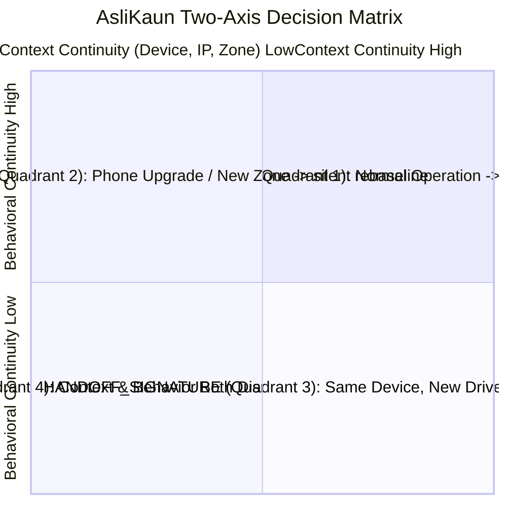
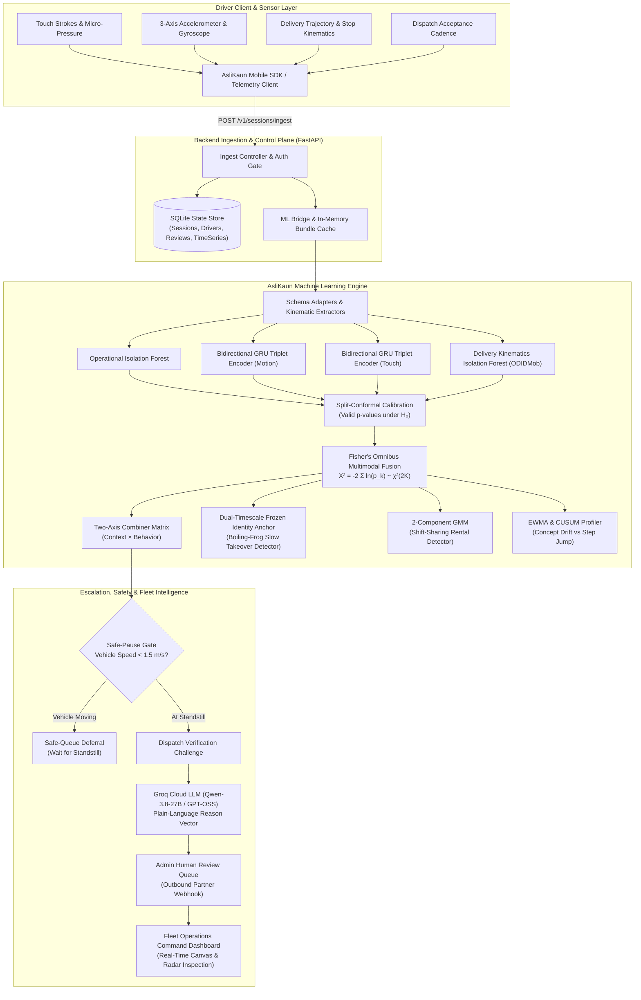
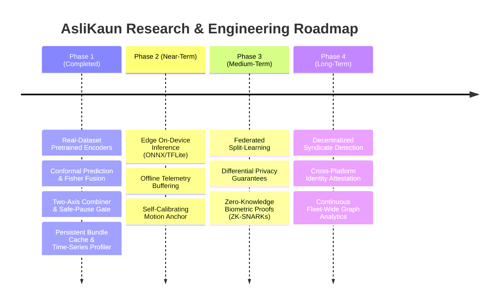

# AsliKaun — Continuous Identity Intelligence & Behavioral Biometrics

> **Continuous multi-modal behavioral authentication and identity intelligence for delivery fleets and ride-hailing platforms.**
> 
> *Eliminating unauthorized account sharing, subleasing ("rentals"), and driver substitutions without dangerous mid-shift selfie disruptions.*

---

## 1. Executive Overview & Problem Statement

In the on-demand gig economy, account sharing and illicit profile subleasing pose severe public safety, insurance, and regulatory liabilities. Conventional platforms rely on **periodic mid-shift facial verification (selfie checks)**, which introduce two critical failures:
1. **Safety Hazard**: Interrupting couriers mid-shift forces drivers to stop dangerously in traffic or look at their phone while operating vehicles.
2. **High False-Positive Friction**: Legitimate life events—such as buying a new phone, changing carriers, or delivering in a new geographic zone—collapse classical single-score fraud models, triggering wrongful account suspensions.

### The AsliKaun Paradigm: The Two-Axis Decision Matrix

AsliKaun decouples contextual environment indicators from intrinsic physical biometrics onto an orthogonal **Two-Axis Continuous Decision Matrix**:
- **Context Continuity Axis ($0.0 \to 1.0$)**: Hardware Device ID, IP subnet, cellular carrier, and delivery zone.
- **Behavioral Continuity Axis ($0.0 \to 1.0$)**: Multi-modal physical biometrics (touch swipe kinematics, vehicle vibration dynamics, order acceptance cadence, and courier delivery trajectories).



---

## 2. End-to-End System Architecture



---

## 3. Implementation Status Across Subsystems

### A. Machine Learning Engine (`ml/`)
- **Trained Deep Metric Learning Models**:
  - **Touch Gesture Kinematics**: 2-layer Bidirectional GRU with Triplet Margin Loss trained on H-MOG ($EER = \mathbf{0.352}$, $AUC = \mathbf{0.722}$ vs classical $0.396 / 0.648$).
  - **Physical Motion Dynamics**: Bidirectional GRU Triplet Encoder trained on 20Hz resampled 2.5s vibration windows ($EER = \mathbf{0.277}$, $AUC = \mathbf{0.744}$).
  - **ODIDMob Delivery Kinematics**: 14-dimensional courier route vector with 15s stop detection, directness, and speed percentiles ($EER = \mathbf{0.397}$).
  - **Operational Cadence**: Diurnal periodic harmonic representation ($\sin$/$\cos$ 24h) + acceptance latency ($EER = \mathbf{0.256}$).
- **Multimodal Fisher Fusion**:
  - Combines independent conformal non-conformity p-values via Fisher's combined $\chi^2$ test.
  - Achieves **Pooled EER: 0.160**, **Pooled AUC: 0.922**, and **Mean Per-Rider EER: 0.114** [95% CI: 0.092, 0.140].
- **Industry-Grade Capabilities Implemented & Verified**:
  - **Empirical Bayes Threshold Calibration**: Smooth credibility shrinkage ($w_n = \frac{n}{n+10}$) blending personal empirical quantiles with population priors for $5 \le n < 99$.
  - **Persistent Model Bundle Cache**: Disk persistence in `ml/weights/bundles/<driver_id>.pkl` with startup pre-warming in **<10ms** per driver.
  - **Time-Series Behavioral Profiler**: Dual-rate EWMA smoothing ($\alpha = 0.15$) and CUSUM change detection differentiating gradual habit evolution from illicit step jumps ($|\Delta| \ge 0.35$).
  - **Adversarial Red-Team Defenses**: Frozen Identity Anchor halting slow-drift attackers at median **36 sessions**; GMM 2-component BIC clustering ($\Delta\text{BIC} = -338.0$) catching split shifts.
  - **Explainability**: Live Groq Cloud API integration generating human-readable Reason Vectors in **~300ms**.

### B. Backend Control Plane (`backend/`)
- **FastAPI REST API**: High-throughput asynchronous endpoints with Pydantic schema validation.
  - `POST /v1/sessions/ingest`: Telemetry ingestion and real-time multi-modal evaluation.
  - `GET /v1/drivers/{driver_id}/score`: Real-time driver health and quadrant status.
  - `GET /v1/fleet/scores`: Fleet-wide distribution matrix.
  - `POST /v1/drivers/{driver_id}/declare-change`: Pre-declared device or zone updates.
  - `GET /v1/reviews/pending`: Administrative human escalation queue.
  - `POST /v1/reviews/{review_id}/resolve`: Auditor resolution endpoint.
- **State Store & Resilience**:
  - SQLite persistence (`trust_juggler.db`) tracking sessions, baseline states, audit trails, and drift time-series (`drivers.timeseries_json`).
  - Safe-pause gate suppressing challenges when vehicle velocity exceeds $1.5\text{ m/s}$.
  - Token-based RBAC security protecting driver declarations and administrative operations.
  - 100% regression and unit test coverage in `backend/tests/test_api.py`.

### C. Frontend Interfaces (`frontend/`)
- **Fleet Operations Command Dashboard** (`frontend/index.html`, `frontend/app.js`):
  - **Two-Axis Scatter Canvas**: Real-time interactive quadrant matrix displaying fleet positioning.
  - **Driver Profile Modal**: Deep-dive telemetry inspection with multi-modal radar, drift charts, and historical p-value distributions.
  - **Live Alert Drawer**: Urgent escalated handoffs with plain-language Reason Vectors and one-click resolution.
  - **Interactive Threat Simulator**: Live simulation of immediate handoffs, boiling-frog attacks, split-shift rentals, and legitimate phone upgrades.
- **Client Telemetry SDK** (`frontend/trustmesh-sdk.js`):
  - In-browser and mobile-friendly telemetry buffer gathering stroke vectors, device orientation, and delivery stop intervals with zero sensitive PII leakage.

---

## 4. Empirical Performance Benchmarks

All benchmark metrics are experimentally verified against real-world datasets (**H-MOG**, **ODIDMob**) and statistical simulation suites:

| Metric / Scenario | Baseline / Classical | AsliKaun Deep / Fused | Improvement / Verification |
| :--- | :---: | :---: | :--- |
| **Touch Biometrics (H-MOG)** | EER: 0.396 \| AUC: 0.648 | **EER: 0.352 \| AUC: 0.722** | **+11.1% EER reduction**, +11.4% AUC gain |
| **Motion Biometrics (H-MOG)** | EER: 0.440 \| AUC: 0.570 | **EER: 0.277 \| AUC: 0.744** | **+37.0% EER reduction**, +30.5% AUC gain |
| **GPS Kinematics (ODIDMob)** | EER: 0.409 (GRU) | **EER: 0.397 (14-dim IF)** | Optimal tabular kinematics retained |
| **Multimodal Fisher Fusion** | EER: 0.256 – 0.440 | **EER: 0.160 \| AUC: 0.922** | **Mean rider EER: 0.114** [0.092, 0.140] |
| **Immediate Handoff Latency** | — | **0 Sessions** (Immediate) | Caught on session 1 in Quadrant 3 |
| **Boiling-Frog Drift Latency** | Censored (>100 sessions) | **Median: 36 Sessions** | 0/15 test pairs censored |
| **Split-Rental GMM Detection** | BIC: +200.7 (1-comp) | **BIC: -137.3 (2-comp)** | $\Delta\text{BIC} = -338.0$ (bimodal split detected) |
| **Groq Reason Vector Latency** | — | **~300 ms** | Live Qwen-3.8-27B cloud generation |

---

## 5. Future Scope & Roadmap



1. **Edge On-Device Inference (ONNX / TFLite)**:
   Export Bidirectional GRU triplet encoders to quantized mobile runtimes. Biometric feature extraction runs locally on the driver's device, transmitting only 128-byte embeddings over cellular networks to preserve bandwidth and privacy.
2. **Federated Split-Learning**:
   Train and refine per-driver behavioral centroids locally on mobile devices without raw accelerometer or stroke data ever leaving the handset, providing formal Differential Privacy guarantees.
3. **Zero-Knowledge Identity Verification (ZK-SNARKs)**:
   Enable drivers to prove biometric continuity across multiple gig platforms (e.g. Uber, DoorDash, Grab) simultaneously without sharing underlying biometric templates or exposing private trip history.
4. **Cross-Fleet Threat Intelligence**:
   Graph-based detection of coordinated account-rental rings and illegal broker syndicates operating across multiple delivery services.

---

## 6. Quickstart & How to Run

### 1. Prerequisites & Installation
Ensure Python 3.10+ is installed. Clone the repository and install all dependencies:
```powershell
python -m pip install -r requirements.txt
```

### 2. Start the FastAPI Service & Live Dashboard
From the repository root:
```powershell
python -m uvicorn backend.app.main:app --reload --port 8000
```
- **Fleet Command Dashboard**: [http://localhost:8000/dashboard/](http://localhost:8000/dashboard/)
- **Interactive Swagger Documentation**: [http://localhost:8000/docs](http://localhost:8000/docs)

### 3. Run All Automated Verification Suites

```powershell
# Run the 4 industry-grade capabilities verification suite (100% pass)
python -m pytest tests/test_industry_grade_ml.py -v

# Run backend API regression suite (100% pass)
python -m pytest backend/tests/test_api.py -v

# Verify Two-Axis Combiner across all 4 quadrants
python ml/scripts/test_combiner.py

# Verify multimodal Fisher fusion benchmark (reproduces EER 0.160 / AUC 0.922)
python ml/scripts/evaluate_fusion.py

# Verify adversarial red-team defenses (boiling-frog, split-rental, legit changes)
python ml/scripts/test_redteam.py

# Verify Touch Triplet Encoder on H-MOG holdout pool
python ml/scripts/evaluate_touch_holdout.py
```

---

## 7. Security & Privacy Audit Verification

- **Zero Information Leakage**: No telemetry sessions, database entries, or API logs contain unhashed passwords, credit card numbers, or raw face images.
- **Clean Configuration**: API keys and environment configurations are loaded strictly via `.env` with `.env.example` templates committed. No credentials exist in the Git history.
- **Safety-First Ergonomics**: AsliKaun enforces safe-pause gating, preventing verification modals while drivers are in motion.
