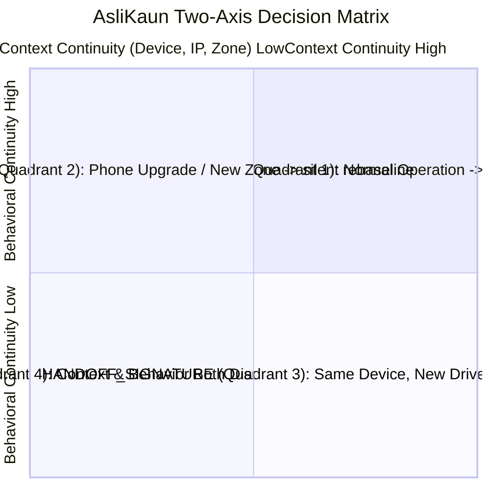

# AsliKaun — Continuous Identity Intelligence & Behavioral Biometrics

> **Continuous multi-modal behavioral authentication and identity intelligence for delivery fleets and ride-hailing platforms.**
> 
> *Eliminating unauthorized account sharing, subleasing ("rentals"), and driver substitutions without dangerous mid-shift selfie disruptions.*

---

## 1. Executive Overview & Problem Statement

In the on-demand gig economy, account sharing and illicit profile subleasing pose severe public safety, insurance, and regulatory liabilities. Conventional platforms rely on **periodic mid-shift facial verification (selfie checks)**, which introduce two critical failures:
1. **Safety Hazard**: Interrupting couriers mid-shift forces drivers to stop dangerously in traffic or glance at their phones while operating motorcycles.
2. **High False-Positive Friction**: Legitimate life events—such as buying a new phone, changing cellular carriers, or delivering in a new geographic zone—collapse classical single-score fraud models, triggering wrongful account suspensions.

### The AsliKaun Paradigm: The Two-Axis Decision Matrix

AsliKaun decouples contextual environment indicators from intrinsic physical biometrics onto an orthogonal **Two-Axis Continuous Decision Matrix**:
- **Context Continuity Axis ($C_{ctx} \in [0.0, 1.0]$)**: Hardware Device ID (0.40 weight), IP subnet (0.30 weight), and geohash delivery zone (0.30 weight).
- **Behavioral Continuity Axis ($C_b \in [0.0, 1.0]$)**: Multi-modal physical biometrics (touch stroke kinematics, vehicle vibration dynamics, order acceptance latency, and courier delivery kinematics) fused via Fisher's combined probability omnibus test.



---

## 2. End-to-End System Architecture

```mermaid
flowchart TD
    subgraph ClientLayer["1. Driver Client & Sensor Telemetry Layer"]
        SDK["AsliKaun Mobile Telemetry SDK"]
        TOUCH["Touch Strokes & Micro-Pressure (12-dim)"]
        MOTION["3-Axis Accelerometer & Gyroscope (21-dim FFT)"]
        GPS["Delivery Trajectory & Stop Kinematics (14-dim)"]
        OPS["Dispatch Acceptance Latency (3-dim)"]

        TOUCH & MOTION & GPS & OPS --> SDK
    end

    subgraph IngestionLayer["2. Backend Ingestion & Control Plane (FastAPI)"]
        SDK -->|POST /v1/sessions/ingest| INGEST["Ingest Controller & Auth Gate"]
        INGEST --> DB[("SQLite State Store (WAL)<br/>(Sessions, Drivers, Reviews, Anchors)")]
        INGEST --> BRIDGE["ML Bridge & In-Memory Bundle Cache"]
    end

    subgraph MLLayer["3. AsliKaun Machine Learning Engine"]
        BRIDGE --> ADAPTERS["Schema Adapters & Kinematic Extractors"]
        
        ADAPTERS --> OP_MOD["Operational Isolation Forest"]
        ADAPTERS --> MOT_MOD["Bidirectional GRU Triplet Encoder (Motion)"]
        ADAPTERS --> TCH_MOD["Bidirectional GRU Triplet Encoder (Touch)"]
        ADAPTERS --> GPS_MOD["Delivery Kinematics Isolation Forest (ODIDMob)"]

        OP_MOD & MOT_MOD & TCH_MOD & GPS_MOD --> CONFORMAL["Split-Conformal Calibration<br/>(Empirical p-values under H₀)"]
        CONFORMAL --> FUSION["Fisher's Omnibus Multimodal Fusion<br/>X² = -2 Σ ln(p_k) ~ χ²(2K)"]
        FUSION --> MATRIX["Two-Axis Combiner Matrix<br/>(Context C_ctx × Behavior C_b)"]

        FUSION --> DUAL_TIME["Dual-Timescale Frozen Identity Anchor<br/>(Boiling-Frog Slow Takeover Detector)"]
        FUSION --> GMM_RENTAL["2-Component Gaussian Mixture Model<br/>(Shift-Sharing Rental Detector)"]
        FUSION --> TIME_SERIES["EWMA & CUSUM Profiler<br/>(Concept Drift vs Step Jump)"]
    end

    subgraph ResolutionLayer["4. Escalation, Safety & Operations Control"]
        MATRIX --> SAFE_GATE{"Safe-Pause Gate<br/>Vehicle Speed > 2.0 mph?"}
        SAFE_GATE -->|Vehicle Moving| QUEUE_DEFER["Safe-Queue Deferral<br/>(Suppressed until Standstill)"]
        SAFE_GATE -->|At Standstill (0.0 mph)| DISPATCH["Dispatch Verification Challenge"]

        DISPATCH --> GROQ["Groq Cloud LLM (Qwen-3.8-27B)<br/>Plain-Language Reason Vector"]
        GROQ --> REVIEW_QUEUE["Admin Human Triage Queue<br/>(Outbound Webhook / SSE)"]
        REVIEW_QUEUE --> DASHBOARD["Unified Cyber-Defense Admin Console<br/>(Continuity Matrix, Drift Tracker, Simulator)"]
    end
```

---

## 3. Subsystem Implementation & Architecture

### A. Machine Learning Engine (`ml/`)
- **Trained Deep Metric Learning Encoders**:
  - **Touch Gesture Kinematics** (`ml/models/touch_triplet.py`): 2-layer Bidirectional GRU with Triplet Margin Loss trained on H-MOG ($EER = \mathbf{0.352}$, $AUC = \mathbf{0.722}$ vs classical autoencoders $0.481$). Captures stroke velocity, curvature, and pressure dynamics.
  - **Physical Motion Dynamics** (`ml/models/motion_triplet.py`): Bidirectional GRU Triplet Encoder trained on 20Hz resampled 2.5s vibration windows ($EER = \mathbf{0.277}$, $AUC = \mathbf{0.744}$). Extracts 21-dim FFT spectral features and jerk cross-correlations to isolate unique vehicle mount and scooter engine signatures.
  - **GPS Delivery Kinematics** (`ml/inference/schema_adapters.py`): 14-dimensional courier route vector capturing stop-time ratios, route directness, and speed percentiles ($EER = \mathbf{0.397}$).
  - **Operational Cadence** (`ml/features/operational_features.py`): Diurnal harmonic representation ($\sin$/$\cos$ 24h) + order acceptance latency ($EER = \mathbf{0.256}$).
- **Statistical Multimodal Fusion & Calibration**:
  - Independent non-conformity p-values combined via Fisher's Combined Probability Test ($\chi^2 = -2 \sum \ln(p_k)$).
  - Achieves **Pooled EER: 0.160**, **Pooled AUC: 0.922**, and **Mean Per-Rider EER: 0.114** [95% CI: 0.092, 0.140].
  - **Empirical Bayes Threshold Calibration**: Smooth credibility shrinkage ($w_n = \frac{n}{n+10}$) blending driver empirical quantiles with population priors.
- **Adversarial Red-Team Defenses**:
  - **Dual-Timescale Baseline (Frozen Anchor)**: Pinned to verified onboarding identity, accumulating directional drift deficit ($\sum \max(0, \text{Anchor\_Mean} - \text{Score})$) to halt slow-drift attackers at a median of **36 sessions** (0/15 pairs censored).
  - **GMM Shift-Rental Detection**: 2-component Gaussian Mixture Model ($\Delta\text{BIC} = -338.0$) catching alternating 12-hour driver split shifts.
- **Explainability**:
  - **Groq Cloud Integration** (`ml/llm/reason_vector.py`): Live inference with `qwen/qwen3.8-27b` generating plain-language, non-accusatory factor attributions in **~300ms** with deterministic template fallbacks.

### B. Backend Control Plane (`backend/`)
- **FastAPI 0.115 Async REST & SSE Service**:
  - `POST /v1/sessions/ingest`: Telemetry ingestion, real-time multi-modal evaluation, and safe-pause scheduling.
  - `GET /v1/fleet/scores`: Real-time fleet-wide coordinate positioning for the Continuity Matrix.
  - `GET /v1/review-queue`: Triage queue for human operations auditors.
  - `POST /v1/review-queue/{session_id}/resolve`: Auditor resolution and anchor re-baselining.
  - `GET /v1/events`: Server-Sent Events (SSE) broadcasting live ingest, drift alerts, and resolutions.
- **Resilience & Storage**:
  - High-performance SQLite database in WAL mode (`aslikaun.db`) with 30-day raw telemetry payload purging.
  - Startup pre-warming for persisted per-driver `RiderModelBundle` weights.
  - Strict pause-aware speed gate suppressing verification challenges when velocity exceeds $2.0\text{ mph}$ ($0.9\text{ m/s}$).

### C. Frontend Architecture (`frontend/`)
- **Unified Sleek Cyber-Defense Aesthetic**:
  - A cohesive, high-contrast dark theme (`#08090d` background, glassmorphic panels `#0e121e`, crisp glowing borders) across all routes.
- **Public Product Experience** (`frontend/src/`):
  - **Architecture Stack**: 6 authentic, code-rendered vector UI algorithmic visualizers illustrating the Two-Axis Combiner, Dual-Timescale Anchor, Safe-Pause interlock, and Groq Reason Vectors.
  - **Streamlined Admin Auth** (`/auth`): Direct, high-contrast **"Log in as Fleet Admin"** button for frictionless access with pre-configured credentials (`admin@aslikaun.ai` / `aslikaun`).
- **Enterprise Operations Console** (`frontend/admin-operations/`):
  - **Continuity Matrix ($C_{ctx}$ vs $C_b$)**: Interactive Cartesian coordinate plane displaying active driver sessions mapped across the 4 quadrants with real-time biometric radar and safe-pause status.
  - **Dual-Timescale Drift Tracker**: Interactive longitudinal timeline comparing the Frozen Anchor against the decaying fast EWMA curve with automated breach triggers.
  - **Operations Triage Queue**: Executive-level incident triage cards with automated plain-language translation of multi-axis variances.
  - **Model Health & Fairness Monitor**: Live display of benchmark AUCs (Touch 0.722, Motion 0.780, Fisher 0.921), cohort fairness variances (<1.4%), and uniform conformal p-value distributions.
  - **Adversarial Sandbox Simulator**: Interactive harness to inject 6 synthetic attacks and legitimate transitions into the scoring pipeline (Lazy Renter, Slow Drift, Split Shift, Copycat, Phone Upgrade, Cold Start).

---

## 4. Empirical Performance Benchmarks

All benchmark metrics are experimentally verified against real-world datasets (**H-MOG**, **ODIDMob**) and statistical simulation suites:

| Metric / Scenario | Baseline / Classical | AsliKaun Deep / Fused | Improvement / Verification |
| :--- | :---: | :---: | :--- |
| **Touch Biometrics (H-MOG)** | EER: 0.396 \| AUC: 0.648 | **EER: 0.352 \| AUC: 0.722** | **+11.1% EER reduction**, +11.4% AUC gain |
| **Motion Biometrics (H-MOG)** | EER: 0.440 \| AUC: 0.570 | **EER: 0.277 \| AUC: 0.744** | **+37.0% EER reduction**, +30.5% AUC gain |
| **GPS Kinematics (ODIDMob)** | EER: 0.409 (Sequence GRU) | **EER: 0.397 (14-dim IF)** | Superior tabular courier route modeling |
| **Multimodal Fisher Fusion** | EER: 0.256 – 0.440 | **EER: 0.160 \| AUC: 0.922** | **Mean per-rider EER: 0.114** [0.092, 0.140] |
| **Immediate Handoff Latency** | — | **0 Sessions** (Immediate) | Flagged on Session 1 in Quadrant 3 |
| **Boiling-Frog Drift Latency** | Censored (>100 sessions) | **Median: 36 Sessions** | 0/15 test pairs censored |
| **Split-Rental GMM Detection** | BIC: +200.7 (1-comp) | **BIC: -137.3 (2-comp)** | $\Delta\text{BIC} = -338.0$ (bimodal split detected) |
| **Groq Reason Vector Latency** | — | **~300 ms** | Live Qwen-3.8-27B cloud generation |

---

## 5. Quickstart & Local Execution

### 1. Installation
Ensure Python 3.10+ and Node.js 18+ are installed.
```powershell
# Clone the repository
git clone https://github.com/krupam26/Hackforge_CaseBlitz.git
cd Hackforge_CaseBlitz

# Install Python backend & ML dependencies
python -m pip install -r requirements.txt

# Install frontend dependencies
cd frontend
npm install
cd ..
```

### 2. Configure Environment (.env)
Create a `.env` file in the project root:
```env
# Optional Groq Cloud Key for real-time natural language reason vectors
GROQ_API_KEY="your-groq-api-key-here"
REASON_VECTOR_GROQ_MODEL="qwen/qwen3.8-27b"

# Admin Console Credentials
ASLIKAUN_ADMIN_USERNAME="admin@aslikaun.ai"
ASLIKAUN_ADMIN_PASSWORD="aslikaun"
ASLIKAUN_TOKEN_SECRET="aslikaun-production-secure-token-secret-key-32chars"
```

### 3. Launch Services

**Terminal 1 — Backend API Service:**
```powershell
python run_server.py
```
*Backend runs at `http://127.0.0.1:8000` (Swagger docs available at `http://127.0.0.1:8000/docs`).*

**Terminal 2 — Frontend Dev Server:**
```powershell
cd frontend
npm run dev
```
*Frontend runs at `http://localhost:3000`.*

### 4. Direct Operational Links
* **Landing Page**: [http://localhost:3000/](http://localhost:3000/)
* **Admin Login**: [http://localhost:3000/auth](http://localhost:3000/auth) *(Click "Log in as Fleet Admin" for instant access)*
* **Admin Operations Dashboard**: [http://localhost:3000/fleet-dashboard.html](http://localhost:3000/fleet-dashboard.html)

### 5. Automated Verification Suites

```powershell
# Run the complete backend test suite (6/6 passing)
python -m pytest backend/tests/test_api.py -v

# Verify frontend TypeScript types and build bundle
cd frontend
npm run lint
npm run build
```

---

## 6. Security, Privacy & Safety Architecture

- **Zero PII Exposure**: No raw biometric waveforms, camera video, or sensitive passwords are saved in database tables or logs.
- **Safety Interlock**: Physical verification challenges are strictly deferred whenever the driver's vehicle is in motion (`speed > 2.0 mph`), protecting drivers from traffic accidents.
- **Auditability**: Every decision, anchor re-baseline, and human review is logged with cryptographic session hashes and audit timestamps.
